# Floor plan feature: test run

**Date:** 2026-10-16
**App:** `compliance-app` on http://127.0.0.1:5001, started with `python tests/browser/serve_e2e.py 5001`. That server uses a fresh temporary asset database and no Wazuh Indexer.
**Data shown:** the bundled **sample fleet**: fictional PCs, labelled "SAMPLE DATA" on every page.

## Results

| Suite | Command | Result |
|---|---|---|
| Python unit/API tests (all) | `python -m unittest discover -s tests -t .` | **155 passed**, 1 skipped (skipped before this feature too) |
| Browser: existing dashboard flows | `playwright-cli run-code --filename=tests/browser/dashboard_flows.js` | **37/37 checks passed** |
| Browser: floor plan flows | `playwright-cli run-code --filename=tests/browser/floorplan_flows.js` | **27/27 checks passed** |
| Browser: responsive layout (window sizes and live resize) | `playwright-cli run-code --filename=tests/browser/responsive_flows.js` | **125/125 checks passed** |
| Live Wazuh lab, read-only (earlier run) | `tests/browser/live_wazuh_smoke.js` against `run_with_wazuh.sh` | 9/9 checks passed |

The browser suites ran in a visible (headed) Chromium window and were rerun after the last CSS change.

### What the floor plan tests cover

- **Placement persistence:** a position survives a page reload (browser) and an app restart (Python: new app instance on the same database).
- **Marker-to-agent association:** a marker is keyed by agent ID and shown only while the PC is still assigned to that building and floor. Another PC on the same floor is unaffected. A live (fake Indexer) agent is placed by its Wazuh agent ID.
- **Filters:** floor, department, compliance status, and offline/stale.
- **Invalid uploads:** these are rejected:
  - SVG
  - a non-image renamed `.png`
  - a JPEG renamed `.png`
  - GIF
  - a file with no extension
  - an empty file
  - a file over 2 MB (HTTP 413)
  - a missing building or floor
  - an upload without the dashboard request header (HTTP 403)
- **Missing location data:** a PC with no building or floor can't be placed (HTTP 400), and the page reports how many such PCs there are. Unknown PCs get 404 and out-of-range coordinates get 400. No position is ever generated automatically.
- **Other:** dropping outside the plan changes nothing, arrow-key nudging, "Remove from plan", no horizontal scroll at 390 px, and the server is bound to 127.0.0.1.

## Walkthrough

### 1. Before any upload
Floors come only from building/floor assignments. The page says that 2 PCs have no building/floor and can't be placed.

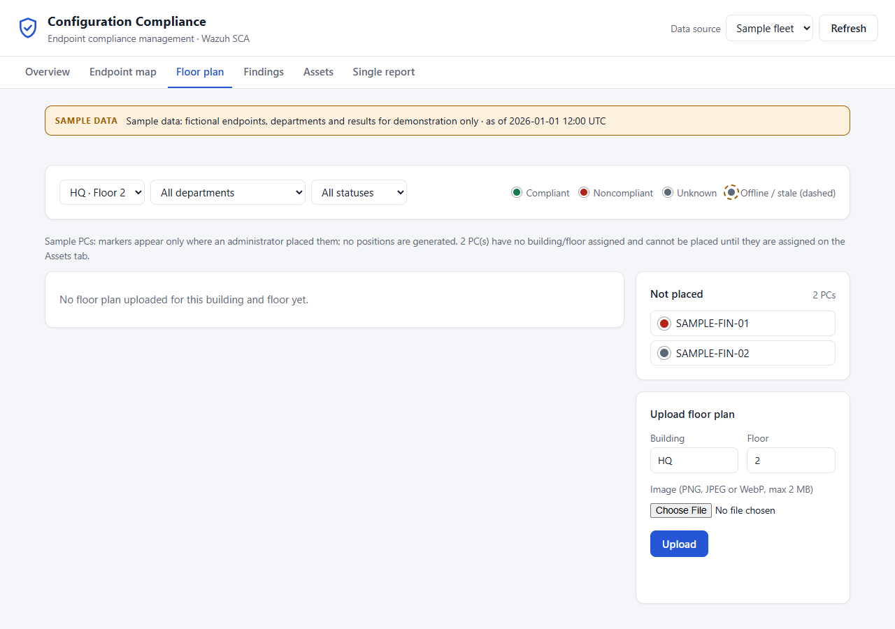

### 2. Invalid upload rejected
A text file renamed `fake.png` is refused, because the server checks the file content, not just the extension.

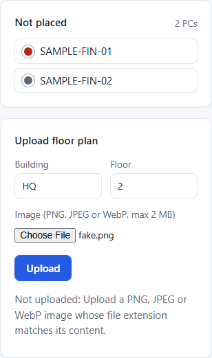

### 3. Plan uploaded, nothing placed
After the upload, both PCs on HQ Floor 2 wait in **Not placed**. No position is invented.

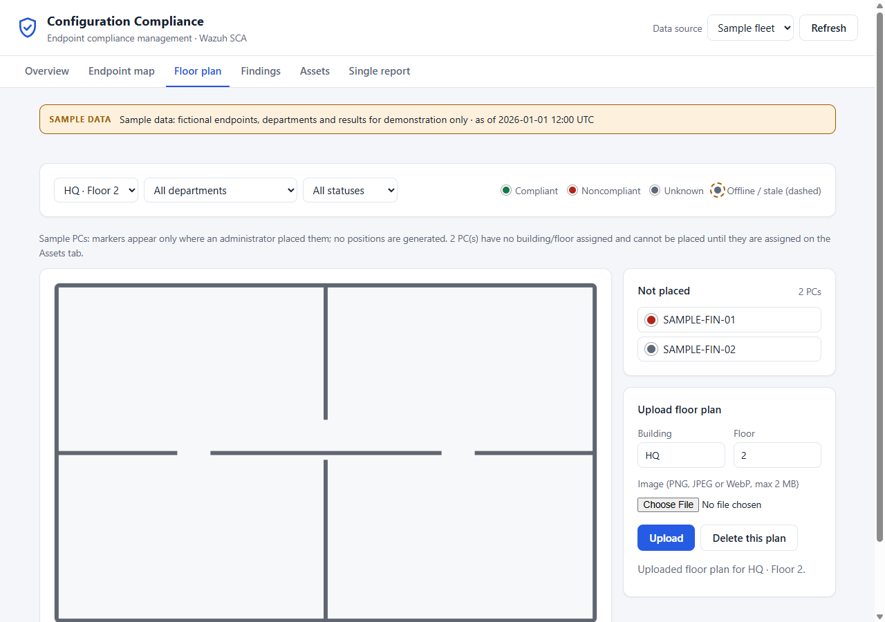

### 4. PCs dragged onto the plan; marker clicked
Red means Noncompliant (SAMPLE-FIN-01) and grey means Unknown (SAMPLE-FIN-02). The panel shows the hostname, agent ID, department, location, compliance % and failed checks with remediation.

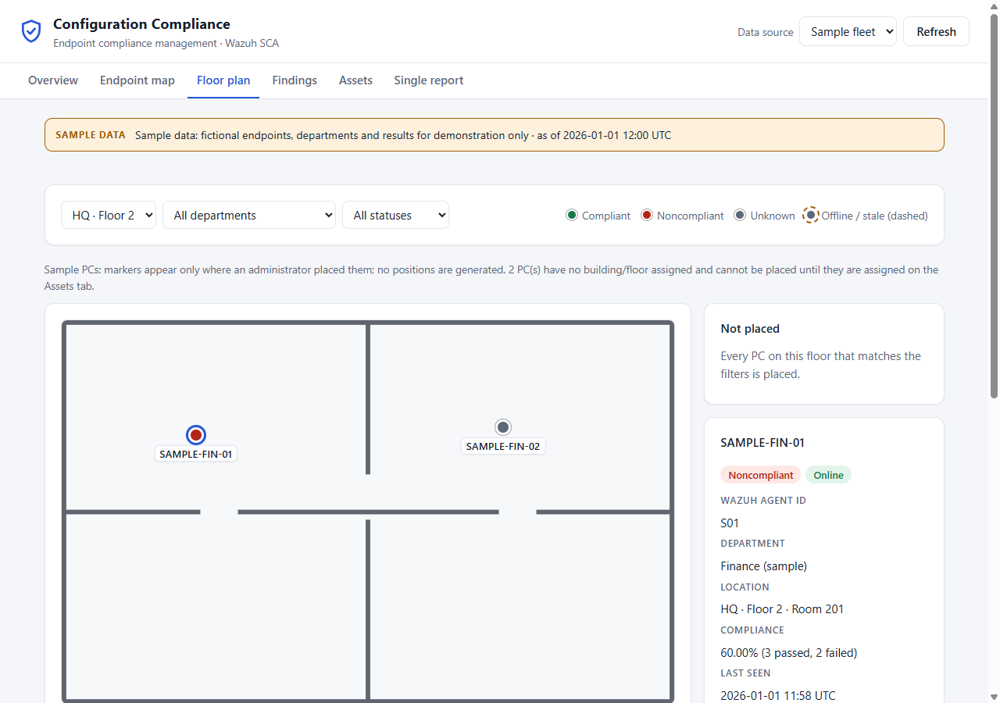

### 5. Failed check opened from the panel
This is the full check record: Wazuh result, what was examined, expected value, rationale, remediation and framework mapping.

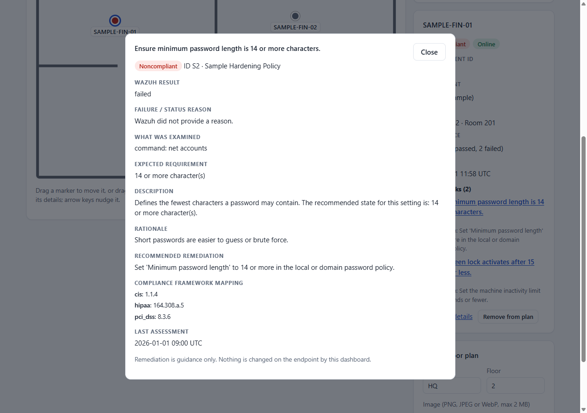

### 6. Floor 1: online vs. stale agent
SAMPLE-IT-01 is compliant and online. SAMPLE-IT-02 has a dashed ring and an italic label, because its agent is stale (no keep-alive for over 1 hour).

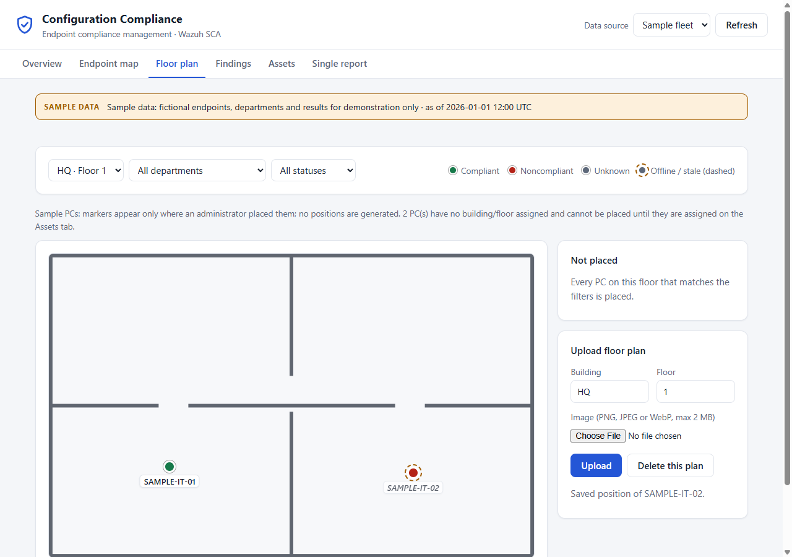

### 7. Status filter "Offline / stale"
Only the stale agent remains on the plan.

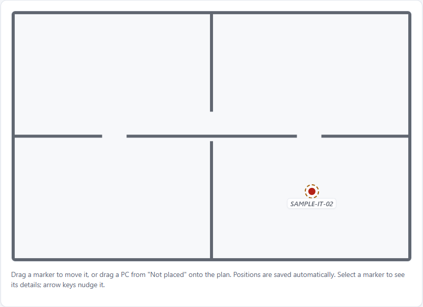

### 8. After a full page reload
The positions were loaded back from SQLite.

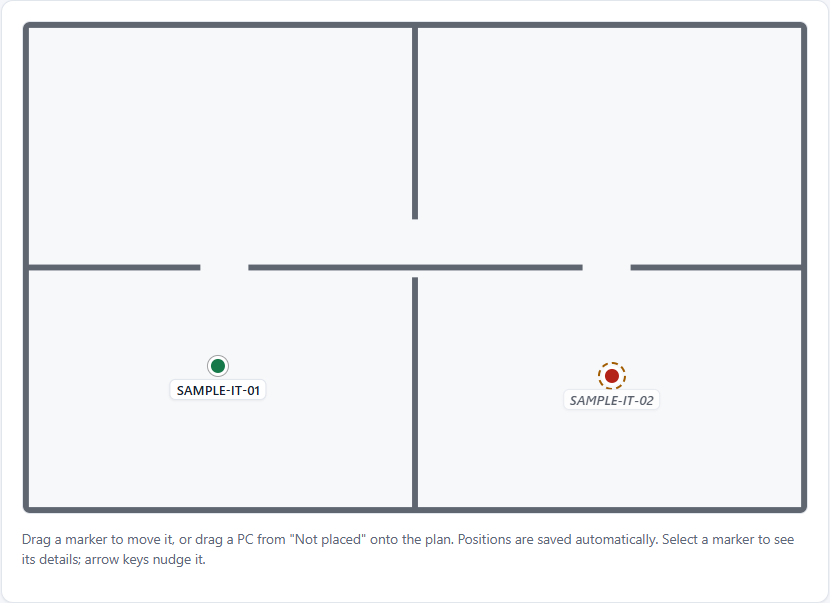

### 9. Phone width (390 px)
The layout stacks, with no horizontal page scroll.

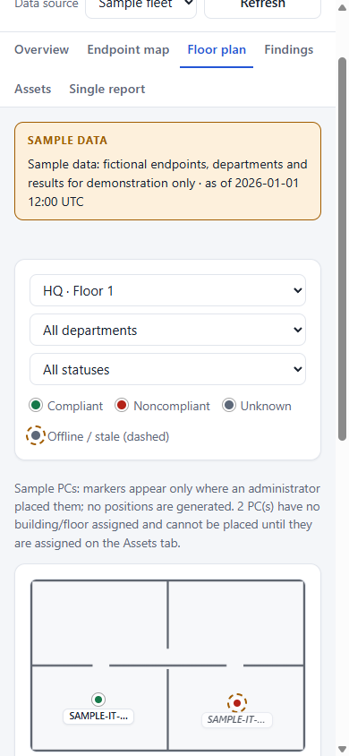

## Fixed during this run

- **Offline/stale markers:** the first version's ring was too faint (it read as a solid dot in screenshot 6). It is now a dashed outline around the dot, and all tests were rerun after the change.

## Not covered

- **Live placement:** your real Wazuh agent `001 win-capstone` has no building or floor assigned in `instance/assets.db`, so it was not placed during the live run. Live placement is covered by a Python test that uses a fake Wazuh Indexer.

## Responsive layout (any resolution, live window resize)

`tests/browser/responsive_flows.js` opens each view once and then **resizes the same page live**, as when you drag the window edge. It covers 7 views (Overview, Endpoint map, Floor plan, PC details, Findings, Assets, Single report) at 15 window sizes:

`320x640, 375x667, 390x844, 600x900, 768x1024, 900x700, 1024x768, 1280x720, 1366x768, 1440x900, 1920x1080, 2560x1440, 3840x2160, 1280x500, 800x400`

At every size it checks:
- **No sideways overflow:** nothing sticks out past the window edge, so the page never scrolls sideways (wide tables scroll inside their own box).
- **Markers on target:** each marker's dot stays within 2 px of its saved position on the plan image.
- **Labels inside the plan:** marker labels stay inside the plan, including markers placed at the very corners.
- **Space is used:** the plan fills the available width, or is capped by the window height so it never gets taller than the screen.

It also checks that the check-details dialog fits at 320×568, 800×400 and 1920×1080, and that dragging a marker after a resize still saves the exact drop point.

**Changes that made this work:**
- **Plan sizing:** the plan scales up and down with the window. It fills the panel width and is capped at about 72% of the window height (85% on short windows). Before, it never grew past the image's own pixel size.
- **Markers and labels:** dot size and label text scale with the window. Labels near the left or right edge shift inward, and near the bottom edge they flip above the dot. This is recalculated on every resize.
- **Narrow windows (1000 px and below):** the side panels move under the plan, in two columns when there is room.
- **Large screens:** the page uses more width (up to 2600 px) and slightly larger text at 1700 / 2300 / 3000 px and wider, instead of a narrow 1200 px column.

| Phone 320x640 | Tablet 768x1024 |
|---|---|
| 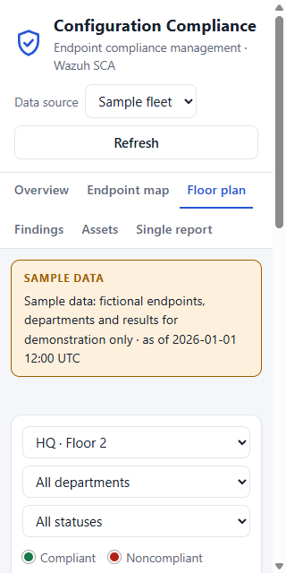 | 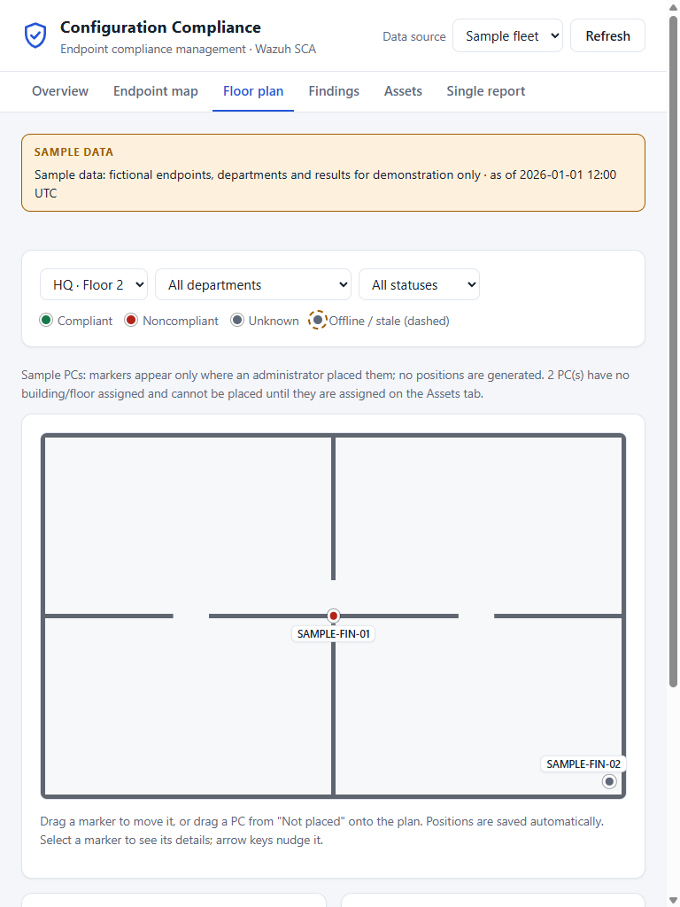 |

| Laptop 1366x768 | 1440p 2560x1440 |
|---|---|
| 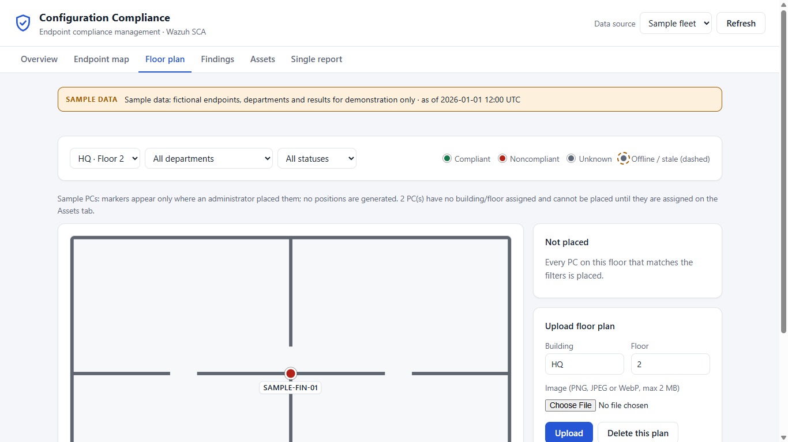 | 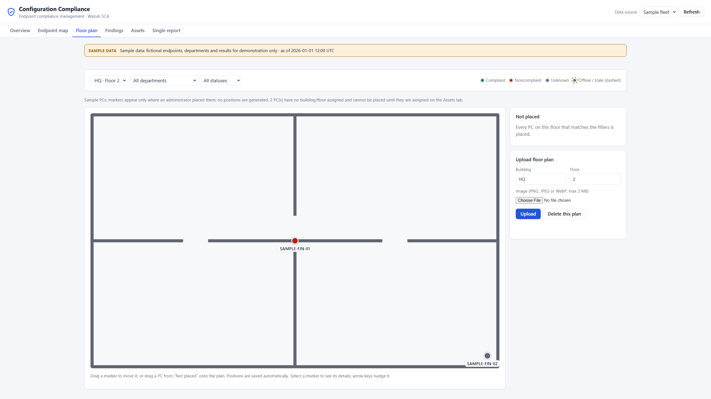 |

4K 3840x2160, Overview:

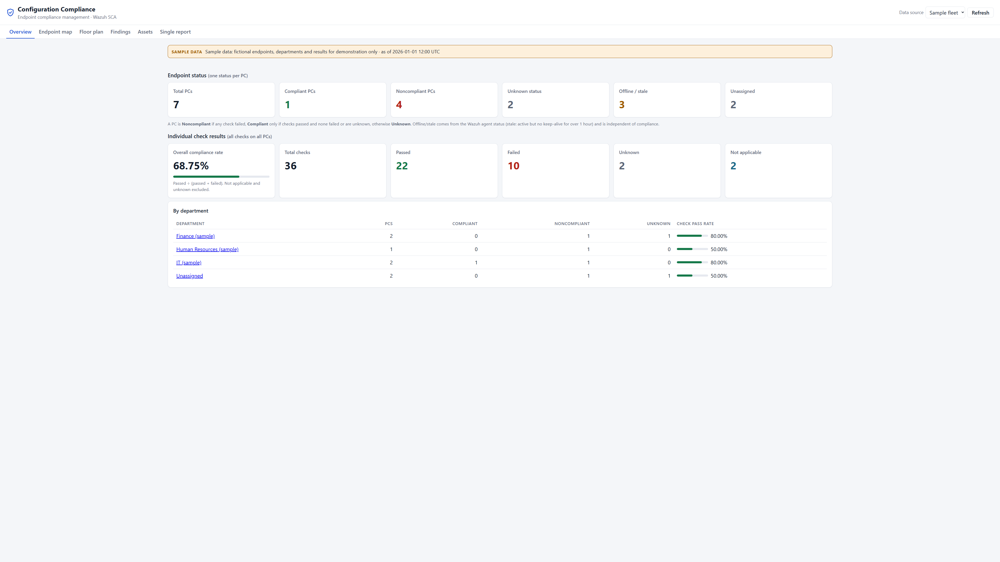
